# 🐱 🪩 Git gud: An Introduction to Git, GitHub, and Collaborative Development

<div align="center">

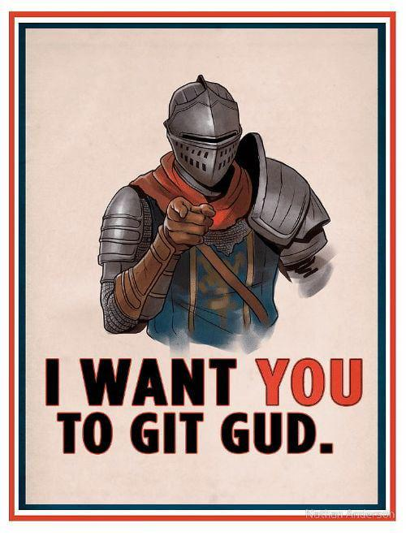

**Distributed Version Control Workshop — Join the Class Dance Floor!**

[](https://razvysme.github.io/GitIntro/)
[](vocabulary.html)
[](.github/workflows/validate-cat.yml)

</div>

---

## 📋 Agenda

1. [What is Git?](#-what-is-git)
2. [Why We Need It](#-why-we-need-it)
3. [Git Vocabulary Cheatsheet](#-git-vocabulary-cheatsheet)
4. [Workshop Task: Join the Dance](#-the-workshop-task-join-the-dance)
   - [Step 1: Clone the Repo](#step-1-clone-the-repo)
   - [Step 2: Create and Switch to Your Own Branch](#step-2-create-and-switch-to-your-own-branch)
   - [Step 3: Create Your `.json` Cat File](#step-3-create-your-cat-configuration-file)
   - [Step 4: Check That Your Local Cat Grooves](#step-4-check-that-your-local-cat-grooves)
   - [Step 5: Stage and Commit Your Changes](#step-5-stage-and-commit-your-changes)
   - [Step 6: Push Your Branch to GitHub](#step-6-push-your-branch-to-github-online)
   - [Step 7: Open a Pull Request (PR)](#step-7-open-a-pull-request-pr-on-github)
   - [Step 8: Merge, Pull, and DANCE!](#step-8-the-grand-finale-merge--pull-)

---

## 🛡️ What is Git?

> **"Git is a safety net that saves timestamped snapshots of your project, letting you track changes, undo mistakes, and collaborate without overwriting each other's work."**

<div align="center">
  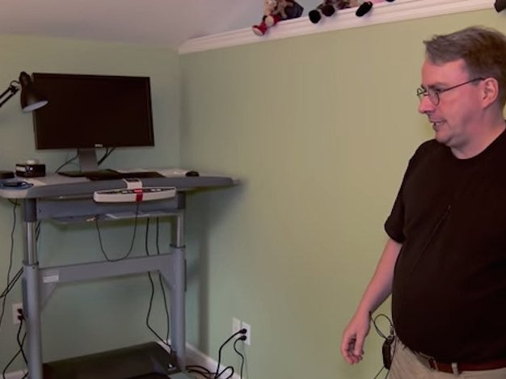
  <p><em>Linus Torvalds, creator of Linux and Git (seen at his walking treadmill desk)</em></p>
</div>

### So, what is Git under the hood?

Git is a distributed system that manages versions of text-editable files (source code, SVG graphics, Markdown, $\LaTeX$, 3D OBJ files, JSON, configuration files, etc.). 

Instead of storing full duplicated copies every time you save, Git captures **timestamped checkpoints (commits)**:
- It records **only the specific lines that changed**.
- It quietly and efficiently links to untouched files, ensuring nothing is lost or duplicated.

---

## 😱 Why We Need It

Before version control, project collaboration often degenerated into this familiar chaos:

<div align="center">
  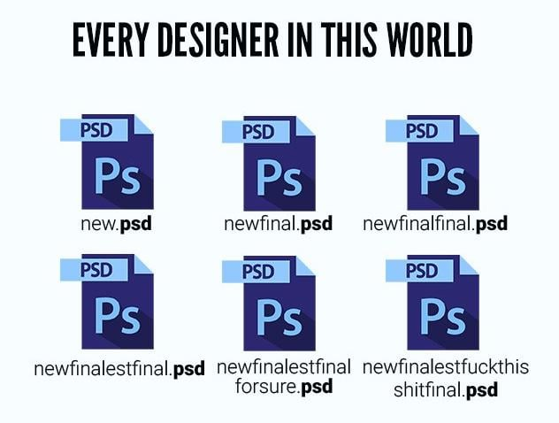
  <p><em>The dreaded manual versioning nightmare: newfinalestfinal_forsure_v2.psd</em></p>
</div>

With Git:
- **No more file renaming:** Every commit is a clean, labeled point in history.
- **Fearless experimentation:** Branches allow you to test new ideas safely without touching stable code.
- **True team collaboration:** Multiple developers work simultaneously on the same project without overwriting one another.

---

## 📖 Git Vocabulary Cheatsheet

Below is a reference guide for the essential Git concepts introduced in the workshop. For an interactive search tool with color-coded concept cards, visit our companion [**Git Vocabulary Guide**](vocabulary.html).

| Term | What It Means |
| :--- | :--- |
| **Repository (`repo`)** | The project folder tracked by Git containing all files, history, and commit checkpoints. |
| **Branch** | An independent line of development. Keeps your experimental code isolated from `master`/`main`. |
| **Fork** | A personal copy of someone else's GitHub repository created on your own GitHub account. |
| **Add / Stage** | Marking specific changed files to be included in your next checkpoint (`git add`). |
| **Commit** | A permanent, timestamped snapshot of staged changes with a descriptive message (`git commit`). |
| **Push** | Uploading your local branch commits to the remote GitHub server (`git push`). |
| **Pull** | Downloading and merging the newest changes from the remote GitHub repository into your local machine (`git pull`). |
| **Merge** | Combining changes from one branch into another (e.g. merging a feature branch into `master`). |
| **Pull Request (PR)** | A proposal on GitHub to merge your branch into the main project, accompanied by code review and automated checks. |
| **Main / Master** | The primary production branch of the repository containing stable, published work. |
| **Rollback / Reset** | Reverting files or the whole project to a previous historical checkpoint if something breaks. |
| **Origin** | The default nickname Git gives to the remote repository on GitHub where you cloned from. |
| **HEAD** | A pointer pointing to the current branch and commit you currently have checked out in your workspace. |
| **Upstream** | The primary source repository from which a fork was cloned or where branches feed into. |
| **`.gitignore`** | A special file specifying intentional untracked files (e.g., build outputs, secrets, system files) that Git should ignore. |

---

## 🪩 The Workshop Task: Join the Dance!

The class goal is to collaborate in real-time: each student designs a custom animated cat in JSON, pushes it via a branch, and opens a Pull Request. Once merged, everyone pulls to see the entire class grooving together on the **Git Disco dance floor**!

```
[Clone Repo] ➔ [Create Branch] ➔ [Add Cat JSON] ➔ [Preview Locally] ➔ [Stage & Commit] ➔ [Push Branch] ➔ [Open PR] ➔ [Pull & Dance!]
```

---

### Step 1: Clone the Repo

Get a copy of the repository onto your machine:
- **Repository URL:** `https://github.com/razvysme/GitIntro`

#### In VS Code:
1. Click **"Clone Repository"** from the welcome screen.
2. Paste `https://github.com/razvysme/GitIntro` into the input bar and press <kbd>Enter</kbd>.
3. Select a destination folder on your machine to save it.

| 1. Click Clone Repository | 2. Paste Repo URL |
| :---: | :---: |
| 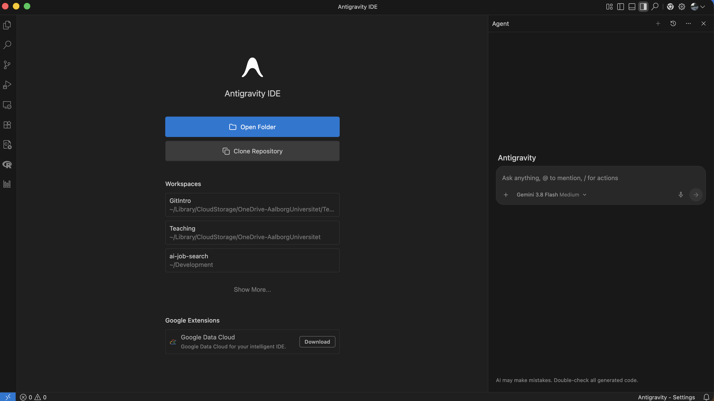 | 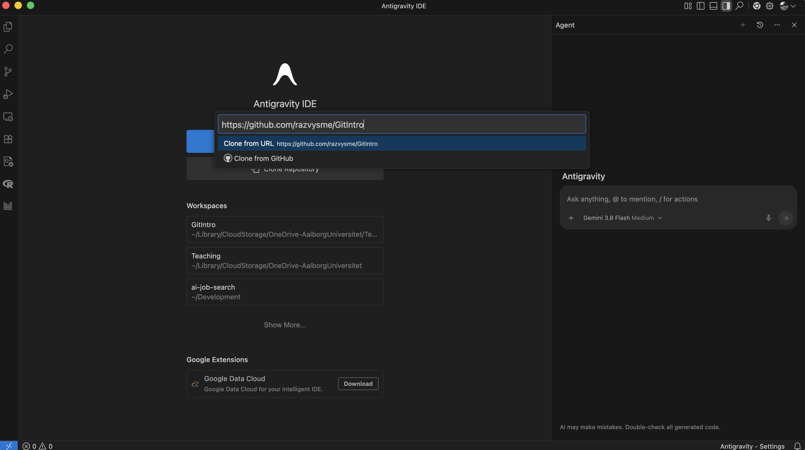 |

#### Or in Terminal:
```bash
git clone https://github.com/razvysme/GitIntro.git
cd GitIntro
```

---

### Step 2: Create and Switch to Your Own Branch

Never develop directly on `master`! Create your own dedicated branch for your cat.

#### In VS Code:
1. Open the **Source Control** tab on the left sidebar (icon with three connected circles).
2. Click the three dots (`...`) in the header $\rightarrow$ **Branch** $\rightarrow$ **Create Branch...**
3. Type a descriptive branch name: `add-cat-[your-username]` (e.g. `add-cat-sarah123`) and press <kbd>Enter</kbd>.
4. Look at the bottom-left status bar: it should now show your branch name instead of `master`!

<div align="center">
  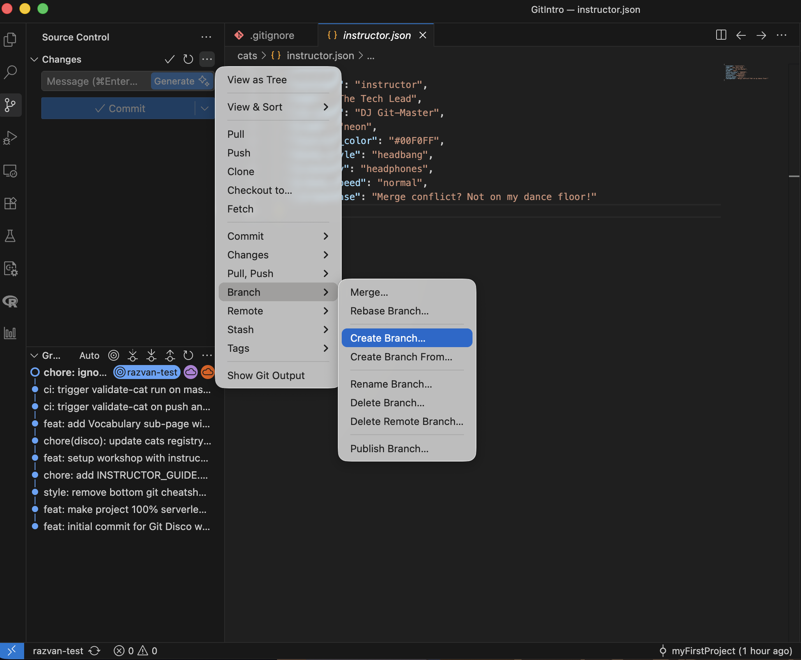
  <p><em>Source Control ➔ Branch ➔ Create Branch. Check that the bottom-left status bar displays your branch name!</em></p>
</div>

#### Or in Terminal:
```bash
git switch -c add-cat-[your-username]
```

---

### Step 3: Create Your Cat Configuration File

1. In the `cats/` folder, duplicate `TEMPLATE.json` and name your new file `cats/[your-username].json` (e.g., `cats/sarah123.json`).
2. Fill out your cat's personality and dance credentials:

```json
{
  "username": "sarah123",
  "name": "Sarah Connor",
  "cat_name": "CyberCat-9000",
  "breed": "neon",
  "favorite_color": "#00FFCC",
  "dance_style": "breakdance",
  "accessory": "sunglasses",
  "groove_speed": "hyper",
  "catchphrase": "Come with me if you want to dance!"
}
```

#### 🎨 Customization Reference Table

| Property | Allowed Values | Description |
| :--- | :--- | :--- |
| **`username`** | *Your GitHub handle* | Unique identifier matching your filename |
| **`name`** | *Your real name* | Displayed on hover / student list |
| **`cat_name`** | *Any creative cat name* | Your dancer's stage name |
| **`breed`** | `calico`, `tuxedo`, `ginger`, `siamese`, `void`, `neon` | Body fur patterns and coloring |
| **`dance_style`** | `breakdance`, `bounce`, `spin`, `moonwalk`, `disco`, `headbang`, `robot`, `wiggle` | Keyframe dance animation |
| **`accessory`** | `sunglasses`, `party-hat`, `headphones`, `gold-chain`, `bow-tie`, `crown`, `none` | Accessories rendered onto the cat |
| **`favorite_color`** | Any Hex color (e.g. `#FF007F`, `#00F0FF`) | Neon spotlight color underneath your cat |
| **`groove_speed`** | `chill`, `normal`, `hyper` | Animation oscillation tempo |
| **`catchphrase`** | *Any fun quote or dance mantra!* | Displayed in speech bubble when clicked |

---

### Step 4: Check That Your Local Cat Grooves!

**No server or installation required!**
Simply open `index.html` in your web browser:
- **Mac:** `open index.html` (or double click `index.html` in Finder)
- **Windows:** `start index.html` (or double click in File Explorer)
- **Linux:** `xdg-open index.html`

> [!TIP]
> **Previewing Your Cat:**
> On the dance floor interface, click **"📂 PREVIEW MY CAT"** and select your `cats/[your-username].json` file, or simply **drag and drop** your file anywhere onto the dance floor window!

<div align="center">
  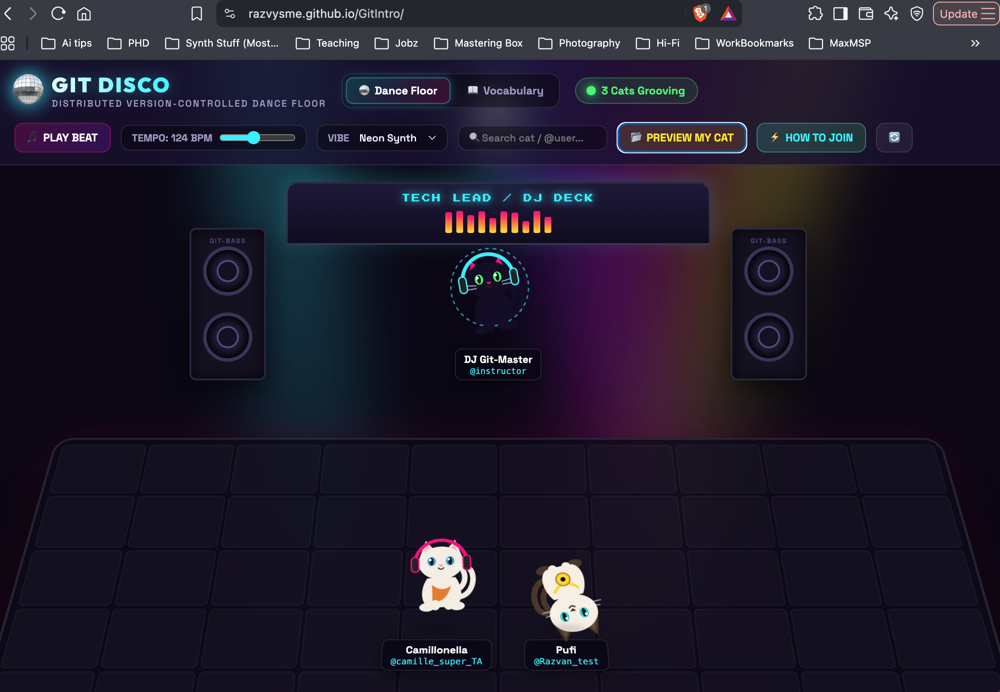
  <p><em>Check out your cat grooving on the dance floor!</em></p>
</div>

#### 🎵 Bonus Tasks (Slide 13)
- Hit **PLAY BEAT** to hear the procedural 808 disco kick and hi-hats.
- Move the **TEMPO BPM** slider to speed up or slow down the dance floor.
- Switch the **VIBE** dropdown (e.g. *Neon Synth*, *Midnight Club*, *Sunset Groove*).
- Click on individual cats to trigger custom animations, meow SFX, and speech bubbles!

---

### Step 5: Stage and Commit Your Changes

Once your cat looks fantastic and passes JSON validation, save your work into a Git checkpoint.

#### In VS Code:
1. Open the **Source Control** tab.
2. In the **Changes** section, hover over your cat file (`cats/[your-username].json`) and click the **`+`** icon to **Stage Changes**.
3. Your file will now move into **Staged Changes**.
4. In the commit text box, type a clear commit message (e.g. `feat(cats): add [your-username] to dance floor`).
5. Click the blue **Commit** button (or press <kbd>⌘</kbd>+<kbd>Enter</kbd> / <kbd>Ctrl</kbd>+<kbd>Enter</kbd>).

| 1. Click `+` to Stage Changes | 2. Staged File Verification | 3. Message & Commit |
| :---: | :---: | :---: |
| 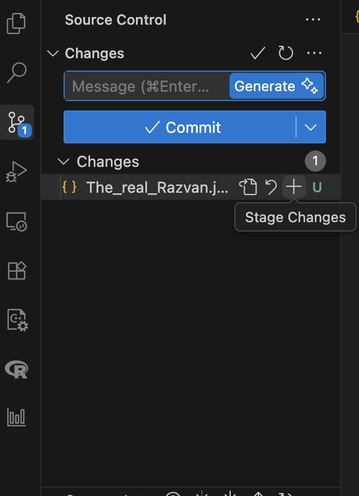 | 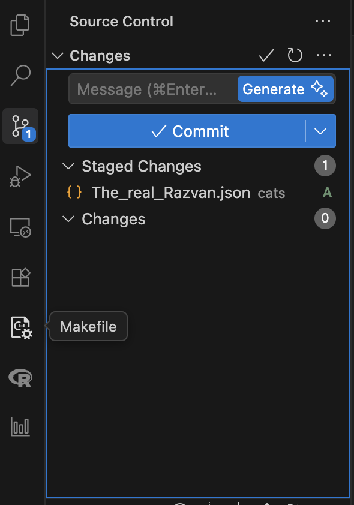 | 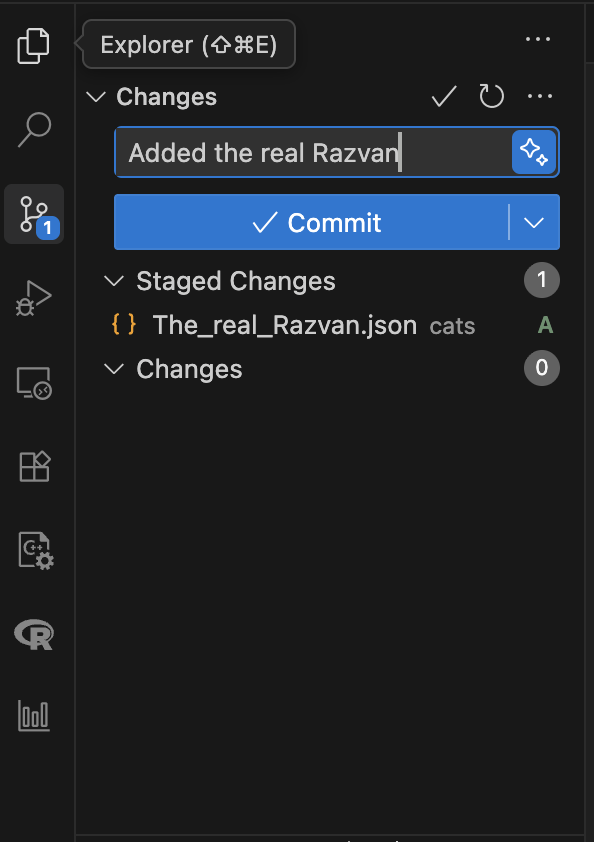 |

#### Or in Terminal:
```bash
git status
git add cats/[your-username].json
git commit -m "feat(cats): add [your-username] to dance floor"
```

---

### Step 6: Push Your Branch to GitHub (Online)

Now publish your local branch and commit to GitHub:

#### In VS Code:
Click the blue **"Sync Changes 1↑"** or **"Publish Branch"** button in the Source Control panel:

<div align="center">
  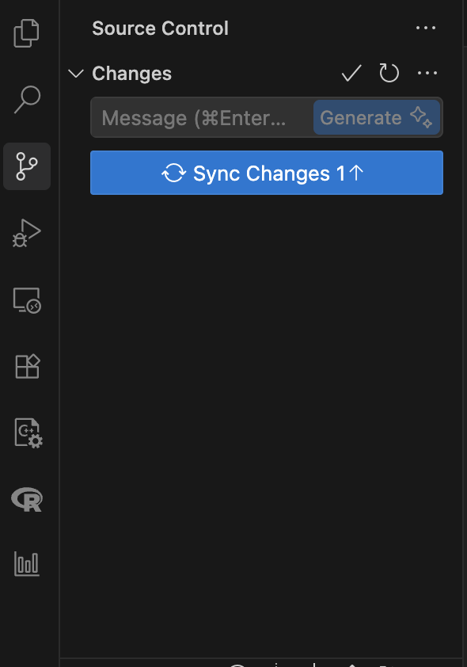
  <p><em>Click "Sync Changes 1↑" or "Publish Branch" to upload your commits to GitHub</em></p>
</div>

#### Or in Terminal:
```bash
git push -u origin add-cat-[your-username]
```

---

### Step 7: Open a Pull Request (PR) on GitHub

Now propose that your branch be merged into the main project:

1. Navigate to the repository on GitHub: [https://github.com/razvysme/GitIntro](https://github.com/razvysme/GitIntro)
2. You will see a banner highlighting your recent push: click **"Compare & pull request"**, or go to **Contribute** $\rightarrow$ **Open pull request**.
3. Verify the branches:
   - **`base: master`** $\leftarrow$ **`compare: add-cat-[your-username]`**
4. Title your PR: `feat: Add [your-username]'s cat to the disco`.
5. Click **"Create pull request"**.

| 1. Contribute -> Open Pull Request | 2. Select Branches & Submit |
| :---: | :---: |
| 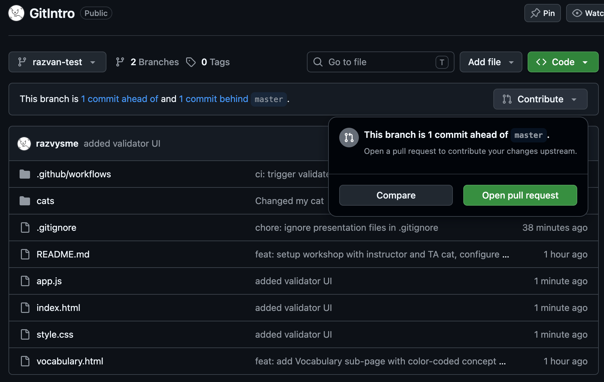 Open pull request button" width="460"/> | 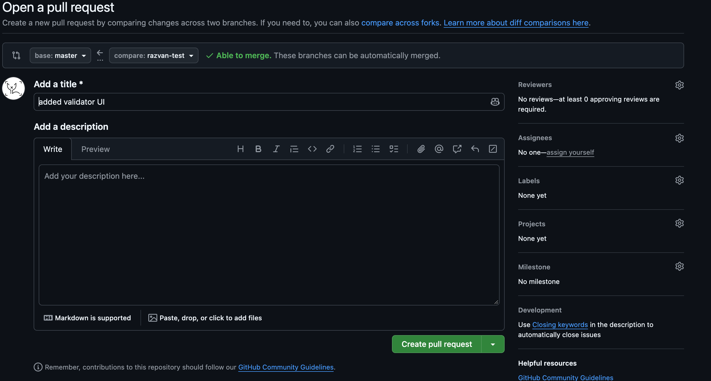 |

> [!NOTE]
> **Automated Cat Quality Assurance (CI):**
> Upon opening your PR, GitHub Actions automatically executes our test suite [`.github/workflows/validate-cat.yml`](.github/workflows/validate-cat.yml). It verifies that your file syntax is valid JSON, all required properties exist, and colors and dance styles match allowed values!

---

### Step 8: The Grand Finale: Merge & Pull! 🎉

1. Your instructor (the Tech Lead) reviews your PR and merges it into `master`.
2. Once the PRs are merged, switch back to `master` and pull all classmate additions:

#### In Terminal:
```bash
git switch master
git pull origin master
```

<div align="center">
  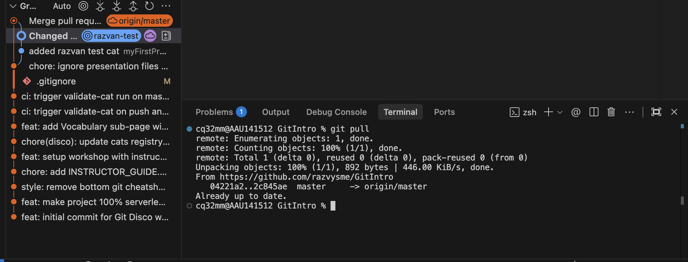
  <p><em>Pulling the merged class commits into your local master branch</em></p>
</div>

3. Refresh `index.html` in your browser.
4. **Turn on PLAY BEAT, turn up the volume, and watch the whole class groove together!** 🪩🐱

<div align="center">
  <h3>✨ Welcome to the Dance! MEEEEEOW! ✨</h3>
</div>
